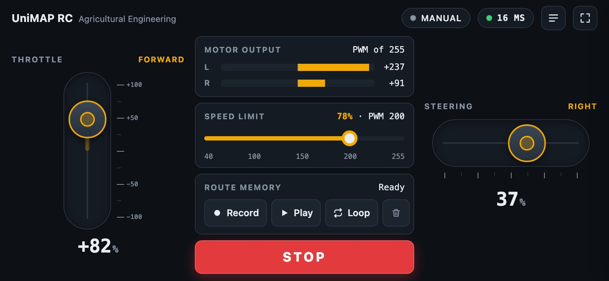

# 🚗 ESP32 RC WiFi Car Controller – UniMAP Edition

This project enables remote control of a 4-wheel car using an ESP32 microcontroller over a WiFi Access Point, designed for educational STEM programs and agricultural automation use at Universiti Malaysia Perlis (UniMAP). The ESP32 serves a sleek browser interface for real-time movement control, speed tuning, and motion recording.

## 📦 Project Structure

```
.
├── ESP32_RCWIFI.ino                         # Single Arduino sketch: motor control + arcade drive mixing + optional obstacle detection
├── html_page.h                              # Embedded HTML/JS served by ESP32 (dual-joystick landscape UI)
├── firmware/                                # Prebuilt, ready-to-flash binaries (see below)
│   ├── merged.bin
│   ├── bootloader.bin
│   ├── partitions.bin
│   ├── firmware.bin
│   └── flash.sh
├── assets/                                  # Screenshots etc.
└── README.md
```

## 🚀 Features

- ESP32-powered standalone WiFi Access Point (`rc_UNIMAP`)
- Landscape-only dual-lever dashboard for phone/tablet control:
  - Left lever: throttle (forward/reverse)
  - Right lever: steering (left/right)
  - Both levers blend in real time on the ESP32 into true differential-drive motor mixing (arcade-style), so you can steer while moving
  - Portrait mode shows a "turn your phone sideways" prompt instead of the controls
- Speed limit slider (PWM 40–255), scaled by lever deflection
- Route memory: record a drive, then play it back once or on a loop (blended drive is approximated to the closest discrete direction for playback)
- Obstacle detection during replay (JSN-SR04T ultrasonic sensor); safe to leave unwired — readings simply become "no obstacle" if the sensor isn't connected
- Safety:
  - **STOP** halts the motors and cancels any running replay
  - Moving a lever during a replay takes over manual control
  - Link failsafe: if no drive command arrives for 500 ms while driving (phone out of range, app closed, WiFi dropped), the car stops
  - The page also stops the car when you switch away from it or lock the phone
- Keyboard driving on a laptop: W/A/S/D or arrow keys, Space to stop

## 🛠 Hardware Requirements

- ESP32 development board (e.g., ESP32 DevKit V1)
- Dual H-bridge motor driver (e.g., BTS7960 or L298N)
- 4 DC motors and chassis platform
- Power supply (e.g., Li-ion or LiPo battery)
- Jumper wires, basic soldering or breadboard setup
- JSN-SR04T Ultrasonic Sensor (optional, enables obstacle-pause during replay)

## 🔧 Software Requirements

- Arduino IDE with ESP32 board package, **or** PlatformIO (`platformio.org`) — both build the same sketch
- No additional libraries needed (uses native `WiFi.h` and `WebServer.h`)
- `esptool` if flashing the prebuilt binaries directly instead of building from source

## 🌐 Web UI Preview

The page served by the ESP32 is a single self-contained HTML file (`html_page.h`) with no external fonts or scripts, so it works on the car's offline access point.

- **Levers:** touch anywhere in the left or right third of the screen and slide. Where your thumb lands counts as zero, so touching never makes the car jump.
- **Motor output:** live left/right wheel PWM, computed with the same mixing as `driveArcade()` in the sketch. Useful for showing students how throttle and steering combine.
- **Status bar:** current mode (Manual, Recording, Replay · step N, Obstacle · paused) and the round-trip time to the car, or "No link" when it stops answering.
- **Replay log:** the menu button opens the step-by-step log from `/log`.
- **Full screen:** the corner button enters full screen and locks landscape where the browser allows it.





## 🧠 Memory Functionality

- **Record**: starts recording your driving; the button shows the elapsed time. Tap again to save the route (up to 200 steps).
- **Play**: drives the saved route once. If you're still recording, recording stops first.
- **Loop**: plays the route again each time it finishes, until you turn Loop off or press STOP.
- **Clear** (bin icon): deletes the saved route. Tap twice to confirm.

During playback the car pauses while the ultrasonic sensor sees an obstacle closer than 20 cm, and resumes when the way is clear. STOP or moving a lever ends playback.

## 🕹️ Getting Started

1. Upload `ESP32_RCWIFI.ino` via Arduino IDE, **or** flash the prebuilt binaries in [`firmware/`](firmware/) directly with `esptool` (no Arduino IDE needed) — run `firmware/flash.sh /dev/ttyUSB0` (adjust the port for your OS)
2. Connect to the ESP32’s WiFi (SSID: `rc_UNIMAP`)
3. Open browser and navigate to `http://192.168.4.1`
4. Turn the phone sideways, slide the left lever for throttle and the right lever for steering, set the speed limit, and use Record / Play / Loop

## 📦 Prebuilt Firmware

The [`firmware/`](firmware/) folder contains ready-to-flash binaries (PlatformIO, `esp32dev` board):

> ⚠️ These binaries were built before the October 2026 UI redesign and link failsafe. Build from source to get the current version until they are regenerated.

- `merged.bin` — bootloader + partition table + app combined into one image, flash at `0x0`. **Use this one.**
- `bootloader.bin` @ `0x1000`, `partitions.bin` @ `0x8000`, `firmware.bin` @ `0x10000` — the same three pieces kept separately, in case a tool needs them individually.

Flash with `firmware/flash.sh [serial-port]`, or manually:

```
esptool --chip esp32 --port <PORT> --baud 460800 write_flash -z 0x0 firmware/merged.bin
```

Rebuild after editing the sketch with PlatformIO (`pio run`) or the Arduino IDE — these binaries aren't auto-regenerated.

## 🎓 Educational Context

This system was developed to introduce microcontroller programming, motor control, and web-based interfaces in STEM and agricultural engineering modules. Ideal for:

- School and university STEM days
- Workshops on embedded systems
- Prototyping educational robots

## 📜 License

This project is licensed under the **GNU General Public License v3.0**.  
You may redistribute and/or modify it under the terms of the GNU GPL v3.

See the [LICENSE](LICENSE) file or visit https://www.gnu.org/licenses/gpl-3.0.html for more.

## 🙏 Credits

Developed by **Zainal Abidin Arsat**  
In collaboration with the **Agricultural Engineering Department**, Universiti Malaysia Perlis (UniMAP)
